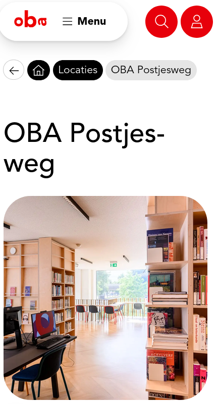
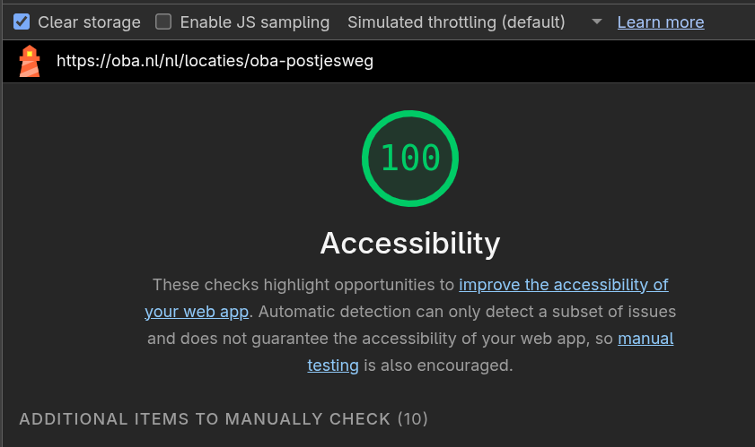

# WCAG Audit 

Doe een WCAG audit op een bestaande website uit je eigen omgeving en rapporteer daarover.

De instructies van deze opdracht staan in [WIKI](https://github.com/fdnd-task/wcag-audit/wiki).

## OBA Postjesweg

Ik heb [OBA Postjesweg](https://oba.nl/nl/locaties/oba-postjesweg) getest.

Hier is de lighthouse-score. 

Ik heb nog geen samenvatting geschreven. Zie [het testresultaat van OBA-Postjesweg](https://github.com/S2108887/wcag-audit/wiki/WCAG%E2%80%90audit-van-OBA-Postjesweg).

## Licentie

This project is licensed under the terms of the [MIT license](./LICENSE).
